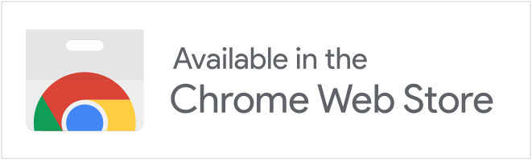

# Watch Later Button

Save YouTube videos to Watch Later in one click. Clean, minimal, privacy-first extension for Chrome, Firefox, and Edge. Zero data collection.

## Download & Install

## Key Features

- **One-click save** - Add videos to your YouTube Watch Later playlist without opening extra menus, with a loading indicator and confirmation when YouTube completes the action.
- **Watch pages, Shorts & video cards** - Save from regular video pages (`/watch`), YouTube Shorts (`/shorts`), and video cards across Home, Subscriptions, Channel pages, and Search results.
- **Configurable undo** - Click the same button again during the circular countdown to remove the saved video. Choose Off, 10 seconds (default), 15 seconds, or a custom duration from 1 to 60 seconds. Saving does not wait for the countdown to finish.
- **Custom keyboard shortcut** - Save or undo with `Alt + W` by default, or record your own combination in Settings. Button tooltips show your configured shortcut, and the hotkey does not trigger while typing in input fields.
- **Appearance controls** - Choose a color preset, use the color picker, or enter HEX/HEX8 values; adjust opacity from 0% to 100% and test the button in the interactive preview. Hover tone and icon contrast are calculated automatically.
- **Per-surface controls** - Independently enable or disable buttons on watch pages, Shorts, and video cards. The keyboard shortcut also respects these switches.
- **Live settings updates** - Changes apply across open YouTube tabs without a reload. Preferences persist across browser restarts, with a one-click reset to defaults.
- **Playlist & update access** - Open Watch Later directly from the popup and choose whether the What's new tab opens automatically after extension updates.
- **26 languages** - Localized interface and button tooltips, with bundled Cyrillic and Latin-Extended fonts for supported languages.
- **Privacy-first** - Zero analytics, zero tracking, no remote scripts, and no user data collection.

## How to Use

Sign in to YouTube in your browser so videos can be saved to your account's Watch Later playlist.

1. **Watch Page:** Click the button beneath the video player, next to YouTube's action buttons.
2. **Shorts:** Click the button in the vertical action panel beside the active Short.
3. **Feeds & Search:** Click the button on a video card. On Home it appears in the thumbnail's upper-left corner; in Search it appears beside the card's menu.
4. **Keyboard:** Press `Alt + W` (or your custom shortcut) for the current video or Short, or hover over a card in a feed and press the shortcut.
5. **Undo:** After a confirmed save, click the same button or repeat the shortcut before the countdown ends. With the undo timer set to Off, only a brief confirmation is shown.
6. **Settings:** Click the extension icon, then Settings to customize appearance, record a shortcut, adjust the undo timer, select button locations, or turn update notifications on or off. Changes save automatically.
7. **Saved Videos:** Open the extension popup and click Watch Later to open your playlist on YouTube.

## Privacy & Security

This extension does **not**:
- Collect personal data
- Track user activity or browsing history
- Communicate with external analytics or tracking servers
- Request unnecessary host or identity permissions

The extension runs in your browser and sends playlist changes to YouTube through your existing signed-in session. Preferences are stored locally and can sync through your browser's built-in settings storage. Content scripts run only on YouTube, and the only additional permission is `storage`.

## Feedback & Support

- [📖 Official Website & Blog](https://watchlater.alxple.com/) - Documentation and release notes
- [🐛 Report an Issue](https://github.com/alxple/Watch-Later-button/issues) - GitHub Issues
- [⭐ Chrome Reviews](https://chromewebstore.google.com/detail/watch-later-button/igehcnnhegiagilpnablldbbcnjabkab/reviews) - Rate on Chrome Web Store
- [⭐ Firefox Reviews](https://addons.mozilla.org/firefox/addon/watchlaterbutton/reviews/) - Rate on Mozilla Add-ons
- [☕ Buy Me a Coffee](https://www.buymeacoffee.com/pletnovalex) - Support project development

## License

This project is licensed under the GNU General Public License v3.0 - see the [LICENSE](LICENSE) file for details.

Crafted with ❤️ in 🇩🇪 for YouTube lovers everywhere.
